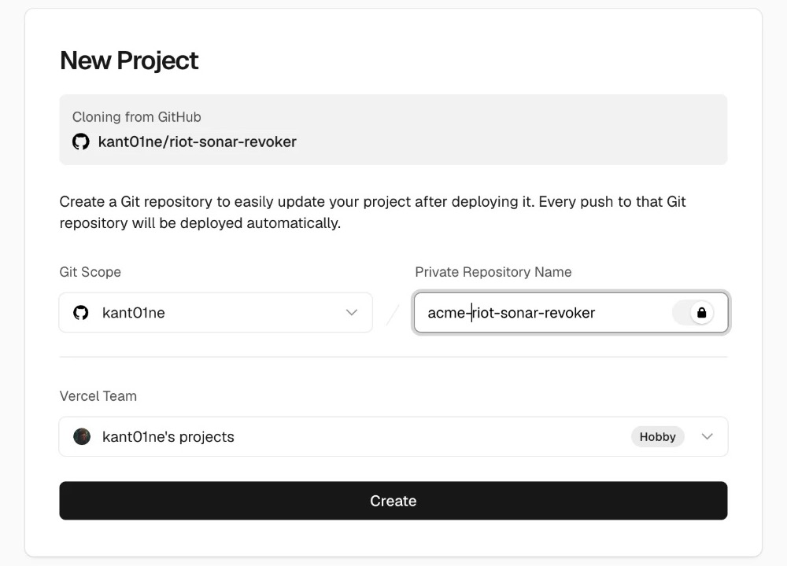

# Riot Sonar Revoker

Receives Riot Sonar revocation webhooks and removes the Google Drive or Microsoft 365 permission with your own credentials.

[](https://vercel.com/new/clone?repository-url=https%3A%2F%2Fgithub.com%2Fkant01ne%2Friot-sonar-revoker&project-name=riot-sonar-revoker)



Pick a repository name and click Create. Once deployed, open the app URL and follow the setup steps.

## Environment variables

| Name | Value |
| --- | --- |
| `RIOT_WEBHOOK_SECRET` | Riot endpoint secret (`whsec_…`). Comma-separate two during rotation. |
| `GOOGLE_SERVICE_ACCOUNT_JSON` | Service account key, raw JSON or base64. |
| `MS_TENANT_ID`, `MS_CLIENT_ID`, `MS_CLIENT_SECRET` | Entra app credentials. |

## Development

```bash
npm install && npm test && npm run dev
```
